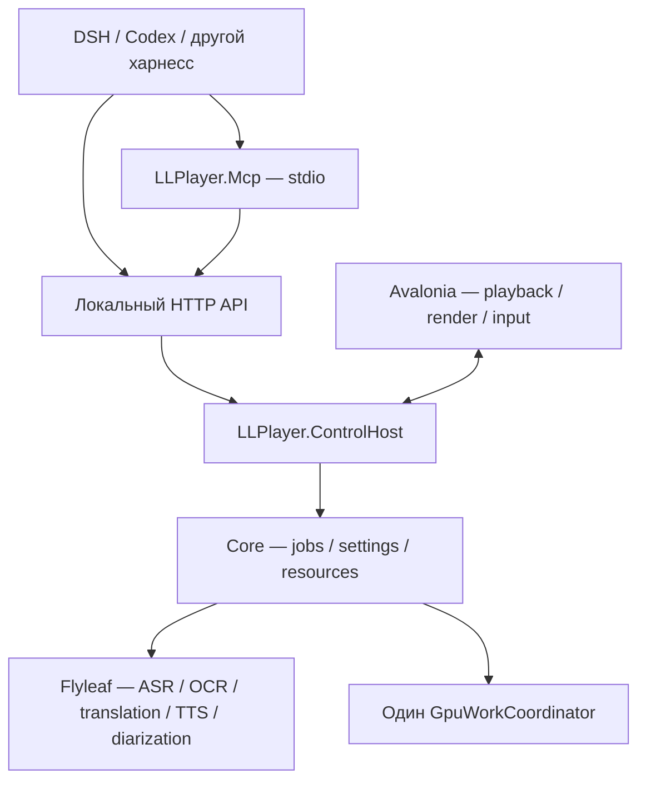

# F-20 — управление LLPlayer из внешнего AI-харнесса

Дата решения владельца — 2026-11-17. Статус — согласованный объём и проект реализации для следующей сессии.
База подготовки — `main d9ed4337da4168e4d2e697b8f27cbf10d51a2be7`, после PR № 205.
Сервер, API и новый фоновый режим ещё предстоит реализовать.

## Результат

Пользователь поручает задачу модели в DSH, Codex или другом харнессе. Агент узнаёт функции и настройки
LLPlayer, выбирает медиа и аудиопоток, запускает Whisper, получает фактический результат ASR, переводит
субтитры и сохраняет результат. Тот же интерфейс даёт доступ ко всем существующим функциям Avalonia
на Windows/Linux. Реализация использует существующие движки, настройки и файловые операции плеера.

Основной пример приёмки — «для этого видео выбери английскую дорожку, создай субтитры Whisper,
переведи их на выбранный язык и сохрани рядом SRT». В другом варианте текущая модель харнесса сама
переводит полученные реплики и возвращает их плееру с исходными идентификаторами и таймингами.

## Принятые владельцем решения

| Решение | Требование |
| --- | --- |
| Подключение | MCP и локальный API на том же компьютере |
| Полномочия | Полный доступ к существующим функциям, сохранённым настройкам и управлению моделями |
| Режимы | Оконный Avalonia и настоящая обработка без окна |
| Перевод | Настроенный провайдер LLPlayer и перевод текущей внешней моделью агента |
| Разрыв соединения | Работа продолжается, статус и результаты сохраняются для нового подключения |
| Сбой исполнителя | Незавершённая задача становится `Interrupted`, возобновление выполняется явной командой |
| Подключение окна | Окно показывает и управляет уже работающей фоновой задачей без её остановки |
| Очередь проекта | Одна последняя новая карточка F-20, затем F-16, F-19, F-02-full и финальная приёмка F-13 |

Полный доступ разрешает агенту вызывать действия без дополнительного подтверждения каждой операции.
Существующие проверки корректности, занятости модели и конфликтов файлов входят в выполнение команды.
Перезапись задаётся параметром операции. Для нового экспорта значение по умолчанию — `overwrite=false`.
Сетевые обращения провайдера, OpenSubtitles, yt-dlp, AnkiConnect и скачивания происходят при вызове
соответствующей функции. Ключи внешней управляющей модели хранит её харнесс.

## Граница возможностей

Матрица [существующих функций](2026-11-17-f20-agent-control-capabilities.md) задаёт обязательное покрытие.
Она включает playback, дорожки/главы/плейлисты, субтитры/OCR/ASR, перевод, экспорт, Batch/Watch,
модели, слова/словари/Anki, AI Insights, текущие дубляж/диаризацию, capture/медиабэкенды и функции окна.
Все восемь семейств настроек получают чтение, описание и изменение через настоящих владельцев данных.

«Любая модель» означает независимый от провайдера интерфейс для харнесса с MCP или API-инструментами.
Облачная и локальная модель используют одинаковые операции. Возможности конкретного харнесса и его
tool-calling проверяются фактическим подключением. Внешний перевод принимает обычные порции текста,
поэтому поддержка MCP sampling со стороны харнесса не требуется для основного сценария.

Каталог возвращает `supported`, `available`, причину недоступности и требования к ОС, GUI и ресурсам.
UI-операции выполняются в выбранном подключённом окне. При отсутствии окна агент может его открыть.
PDIC и Microsoft OCR сохраняют Windows-границу. Установка XXL на Linux сообщает фактическую поддержку
ручного внешнего executable. Каталог горячих клавиш служит одним из входов проверки полноты.

Этап предоставляет текущие функции F-03/F-16/F-19. Следующие фазы дубляжа и forced alignment остаются
в своих карточках. Проверки реальной модели/GPU, Computer Use и общая нативная приёмка F-13
сохраняют отдельное согласование. F-20 получает собственную проверку настоящего MCP/API-клиента.

## Технический выбор автора плана

Из рассмотренных вариантов выбран постоянный исполнитель с подключаемыми клиентами. Встраивание
сервера только в окно связывает задачу с desktop lifetime. Два независимых исполнителя создают два
GPU-координатора. Общий исполнитель позволяет пережить отключение харнесса и открывать GUI поверх задачи.



### Состав

| Новый компонент | Ответственность |
| --- | --- |
| `LLPlayer.Control` | Лёгкая библиотека `net10.0`, wire DTO, схемы ошибок, интерфейсы операций и HTTP-клиент |
| `LLPlayer.Core/Automation` | Каталог операций, задания, адаптеры существующих сервисов и хранилище прогресса |
| `LLPlayer.ControlHost` | Display-free `net10.0` процесс с локальным API, единственным владельцем ML/GPU и ресурсов |
| `LLPlayer.Mcp` | Тонкий stdio-мост к тому же host через `LLPlayer.Control` |
| Адаптеры Avalonia | Регистрация GUI-сессии, общий клиент, обновление прогресса и защищённая публикация реплик |

`LLPlayer.Control` свободен от ссылок на Flyleaf, Core, Avalonia и WPF. `ControlHost` использует Core и
portable Flyleaf. MCP-мост загружает библиотеку контрактов и официальный SDK. Native playback и render
остаются у GUI. Обмен кадрами по API для этого проекта не требуется.

Один `ControlHost` обслуживает текущего пользователя и активный профиль конфигурации. Запуск клиентов
разрешается через межпроцессное владение и проверенную discovery-запись, включая одновременный startup.
Попытка подключить несовместимый активный профиль возвращает `profile_conflict`. Идентификатор процесса
дополняется случайным `instanceId` и проверкой версии API. Новый бинарник сохраняет уже идущие задания,
а при несовместимом протоколе сообщает необходимость явного завершения старого host.

Host создаёт служебный последовательный dispatcher для нужных Flyleaf-вызовов без desktop lifetime.
Headless-приёмка запускает его с удалёнными `DISPLAY`/`WAYLAND_DISPLAY` и без GUI/audio device initialization.
GUI запускается обычным apphost, регистрирует `sessionId` и двусторонний канал команд/событий.
Операции окна, вывода звука, render и clipboard направляются в этот канал на UI dispatcher.

Локальные файлы обрабатываются из неизменяемого source snapshot с точным индексом выбранной дорожки.
Для поддерживаемого конечного GUI-источника, который нельзя переоткрыть в host, GUI передаёт PCM
по локальному каналу с sequence, sample clock и source revision. Host сохраняет принадлежащий заданию
input snapshot, необходимый для самостоятельного продолжения. Канал имеет bounded backpressure и отмену.
Смена источника инвалидирует старые samples. Закрытие источника до полного приёма входа даёт явное
`Interrupted/source_unavailable`. После приёма входа host продолжает работу самостоятельно.
Существующий запрет ASR для `IsLive` сохраняется и описывается каталогом. Capture/playback остаются
самостоятельными возможностями, их наличие не означает поддержку ASR живого потока.

Все управляемые ML-задания из GUI и API переходят к host, включая интерактивное ASR, Batch/Watch,
диаризацию и дубляж. GUI больше не создаёт конкурирующего владельца этих задач. Его закрытие отсоединяет
представление и освобождает собственные playback-ресурсы. Явная команда остановки host закрывает admission,
отменяет задания и ждёт подтверждённого drain дочерних процессов.

## Общий контракт операций

Публичная версия API — `v1`. Имена операций и конкретные DTO закрепляются при первом шаге реализации.
Следующие сигнатуры определяют общий шов, которым пользуются оба транспорта и GUI.

```csharp
ControlScope(ProfileId, SessionId?)
ControlRequest(RequestId, OperationId, Scope, ExpectedRevision, JsonElement Arguments)
ControlResult(JobId?, Revision?, JsonElement? Value, ControlError?)

IPlayerControlService.DescribeAsync(ControlScope, CancellationToken)
IPlayerControlService.GetStateAsync(ControlScope, CancellationToken)
IPlayerControlService.InvokeAsync(ControlRequest, CancellationToken)

IControlJobService.GetAsync / ListAsync / CancelAsync / RetryAsync / ResumeAsync
```

`RequestId` — UUID и ключ идемпотентности. Повтор в том же профиле с теми же нормализованными аргументами
возвращает прежний результат или `jobId`. Иное содержимое с тем же ключом возвращает конфликт.
Описание операции содержит JSON Schema входа/результата, побочные эффекты, тип завершения, доступность
и требуемый контекст. Мутации используют типизированные адаптеры реальных сервисов.

Маршруты API охватывают `/v1/capabilities`, `/v1/state`, `/v1/operations`, `/v1/jobs` и наблюдение событий.
MCP предоставляет discovery и доменные инструменты поверх того же контракта. Названия из матрицы —
начальный каталог. Параметризованный вызов проверяет схему до входа в операцию. Каждая новая страница
результатов имеет cursor, а события — последовательный номер для восстановления наблюдения.

Плеер отдаёт отсоединённые снимки. `mediaId`, `slotId`, `cueId`, `trackId`, `sessionId` и revision
разрешаются сервером через текущих владельцев. Native-объекты и внутренние reference-token не сериализуются.
Устаревшие handles дают структурированный конфликт. Ошибки различают невалидные параметры, занятость,
недоступную функцию, смену источника, сбой провайдера, отмену и неподтверждённую остановку.

## Задания и сохранение

Обычный долгий вызов быстро возвращает `jobId`. Статусы — `Accepted`, `WaitingForResource`, `Running`,
`AwaitingTranslation`, `Cancelling`, `AwaitingCleanup`, `Completed`, `Failed`, `Cancelled`, `Interrupted`.
Клиент может отдельно получить этап, прогресс, результат по файлам, артефакты и причину ошибки.
Отмена запроса status или разрыв MCP/HTTP не отменяют уже принятую задачу. Для этого есть `CancelAsync`.

Хранилище `<StateDir>/Automation/jobs.sqlite` использует уже закреплённые в Core `Microsoft.Data.Sqlite`
и `SQLitePCLRaw.bundle_e_sqlite3`. Версия схемы, миграция и восстановление проверяются регрессиями.
Транзакция сохраняет запрос и уникальный `(profileId, requestId)` до подтверждения его приёма. Журнал
хранит checkpoints, снимок настроек, input identity, результаты и владеющие временные пути.
Учётные данные остаются в существующих settings owners и не копируются в журнал. Для операций set/clear
секреты исключаются из сохранённых arguments и снимков. Идемпотентность сравнивает их защищённый
fingerprint, а recovery не воспроизводит секретную запись из старого запроса.

После сбоя незавершённые задачи становятся `Interrupted`. Resume проверяет актуальность входа,
целостность уже опубликованных результатов и границы checkpoints. Запись файлов использует staging и
атомарную публикацию. Если внешний эффект вроде отправки в Anki произошёл перед сбоем и подтверждение
не сохранилось, API сообщает неопределённый исход и требует явного решения о повторе этого эффекта.
Пауза/возобновление ASR и повтор failed-job остаются разными операциями.

Перезапущенный host подтверждает завершение ранее принадлежавшего ему дерева движков до нового
GPU admission. Существующий kill-on-close/supervisor обеспечивает остановку, а восстановление учитывает
задержку её подтверждения. При неизвестном состоянии прежнего дерева статус остаётся `AwaitingCleanup`.
Журнал сохраняет принадлежащую запуску process identity с временем старта и group/job ownership.
Исчезновение одного host PID не снимает защиту моделей. API диагностики доступен во время recovery,
а новые конфликтующие GPU-задания и удаления активных моделей ждут подтверждённой очистки.

Неподтверждённый process drain удерживает GPU/ресурсное владение и показывает `AwaitingCleanup`.
Retry cleanup затрагивает своего владельца. Защита скачанных моделей и файлов применяет существующий
`LanguageResourceCoordinator`. Журнал, DB/WAL/SHM, токены и результаты становятся per-user runtime state
и проверяются на отсутствие в Git и пакетах.

## Два пути перевода

Для провайдера LLPlayer операция полного документа принимает source/target language и снимок настроек.
Интерактивный playhead-window translator и batch translator с нынешним фиксированным Russian не заменяют
эту операцию. Реализация выделяет общий перевод списка и сохраняет прежний default русского батча.

Для модели харнесса ASR заканчивается с подтверждённым drain и освобождением GPU-допуска LLPlayer.
Задача переходит в `AwaitingTranslation`. Агент читает порции исходных реплик с cue IDs, revision,
target language и контекстом, затем отправляет переведённый текст. Частичные порции сохраняются в draft.
Явный commit проверяет полноту, уникальность ID, исходную revision и отсутствие подмены таймингов.
Commit публикует весь перевод атомарно. Порядок, исходный текст, стили и speaker/voice metadata сохраняются.
Повтор отправки либо commit идемпотентен. Пока ответ внешней модели ожидается, LLPlayer GPU lease свободен.

Координатор управляет ML-работой host. Внешний LLM-сервер, hardware playback и другие приложения имеют
собственные ресурсы. API сообщает ожидание и владельца LLPlayer, позволяя харнессу применять свой
существующий GPU-брокер. Общемашинная координация внешней модели потребует отдельного подтверждения.

## Настройки и полномочия

API читает requested/effective/pending значения и схемы всех settings families. Изменение идёт через clone,
validation, свежий merge затронутых полей и persist-before-apply. Поле saved-next-start явно отмечено.
Активная обработка использует свой снимок. Конфликт с новым UI/API значением возвращает revision conflict.
Credential readback показывает маску/наличие, set/clear записывает через существующего владельца без echo.

Локальный endpoint привязан к loopback. Разрешение текущему пользователю задаётся при подключении.
Для API используется непубликуемый bearer credential и private discovery-файл с правами пользователя,
для stdio — окружение/локальный контекст. HTTP проверяет Origin/Host и размер входного сообщения.
API не открывает LAN/internet listener. Никаких дополнительных согласований для каждого действия
авторизованного агента этот проект не вводит. Существующие процедуры доступа к gated-моделям сохраняются.

## Протокол и поставка

Проверка первоисточников на 2026-11-17 показала stable MCP `2026-07-28` и C# SDK `2.4.0`.
При реализации повторно сверить stable API, закрепить проверенную версию и notices. SDK обслуживает
современное discovery и старые initialize-клиенты. Проверки покрывают обе фактически заявленные версии.
Приложение использует обычные start/status/result/cancel tools с `jobId`, доступные базовым клиентам.

HTTP-host использует официальный ASP.NET Core hosting. Его framework-dependent поставка требует
ASP.NET Core 10 runtime. Companion runtimeconfig и инструкции должны сообщать это прямо. GUI сохраняет
собственный runtimeconfig, MCP-мост — свою лёгкую зависимость. Avalonia ZIP/tar.gz включают host/bridge,
их зависимости, notices и корректные launcher paths. WPF проверяется штатным гейтом совместимости.

Новые проекты обязательно входят в solution, build/test scripts и пакетные фикстуры, включая
`test-desktop-test-build.ps1`. Добавление только в `.slnx` не обеспечивает запуск их сборки/тестов.
Комплект подтверждает startup из распакованного пакета, чистый stdio stdout и отсутствие runtime state.
Keep2 учитывает долгоживущие host/bridge и их payload/dependency paths при обновлении GUI. Проверки
охватывают apphost и `dotnet LLPlayer.ControlHost.dll` / `dotnet LLPlayer.Mcp.dll`, включая третье обновление.
Нынешний `Add-HostedPaths` распознаёт только Avalonia DLL, поэтому его расширение входит в F-20.

## Критерии готовности F-20

1. Один реальный MCP-клиент и прямой API выполняют discovery/call/status/cancel/result через общий сервис.
2. Согласованный ASR → перевод → экспорт проходит с фактическим ожиданием и проверкой выходных реплик.
3. Оба пути перевода принимают выбранный target language, сохраняют времена/metadata и отклоняют stale import.
4. Полный каталог функций/настроек подтверждён матрицей и тестами через их обычных владельцев.
5. Linux host работает без display и окна. GUI подключается к идущей задаче и отсоединяется без её отмены.
6. Два клиента и GUI получают одного владельца. Отмена, частичный запуск и отказ stop сохраняют GPU/resource lease.
7. Разрыв соединения, повтор запроса, сбой host и явный Resume дают согласованный журнал без скрытого повторения эффектов.
8. Пройдены Windows/Linux/WPF гейты, пакеты, независимое `/review`, согласованная GitHub-доставка,
   свежая сборка за синим ярлыком и scoped Second Brain sync.
9. Реальное подключение как минимум одного доступного харнесса подтверждено отдельно от fake-engine regression.
   Данные его доступа и настройки не публикуются. Отсутствующий харнесс отмечается `NOT_RUN` и не имитируется.

Исполнение описано в [плане](2026-11-17-f20-agent-control-plan.md), запуск следующей сессии —
в [готовом промпте](2026-11-17-f20-agent-control-next-session-prompt.md).

## Первоисточники

- [MCP transports](https://modelcontextprotocol.io/specification/2026-07-28/basic/transports/streamable-http)
- [Версионирование](https://modelcontextprotocol.io/specification/2026-07-28/basic/versioning)
- [Инструменты](https://modelcontextprotocol.io/specification/2026-07-28/server/tools)
- [C# SDK 2.4.0](https://github.com/modelcontextprotocol/csharp-sdk/releases/tag/v2.4.0)
- [ASP.NET runtime reference SDK](https://github.com/modelcontextprotocol/csharp-sdk/blob/v2.4.0/src/ModelContextProtocol.AspNetCore/ModelContextProtocol.AspNetCore.csproj)
- [Существующая граница GPU](../gpu-coordinator-adr.md)
- [Контракт данных](../config-data-contract.md)
